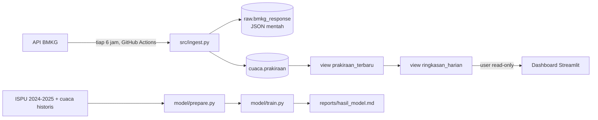

# Peringatan Dini Cuaca dan Kualitas Udara Jakarta

**Dashboard live:** https://cuaca-udara-jakarta-venny.streamlit.app/

Proyek pribadi end-to-end: mengambil data cuaca secara terjadwal dari API publik BMKG,
menyimpannya di database, mengolahnya dengan SQL, lalu menampilkannya sebagai
dashboard peringatan. Tahap akhirnya adalah model prediksi kualitas udara.

## For Who?

Pengguna yang dibayangkan: **petugas promosi kesehatan di puskesmas Jakarta**.
Mereka perlu tahu 2–3 hari sebelumnya kapan wilayahnya akan mengalami hujan lebat,
suhu ekstrem, atau kualitas udara buruk, supaya bisa menyiapkan layanan
(misalnya lonjakan pasien ISPA) dan mengirim imbauan ke warga.

Pertanyaan yang harus bisa dijawab dashboard:
1. Kelurahan mana yang diprakirakan hujan lebat atau panas ekstrem dalam 3 hari ke depan?
2. Bagaimana kualitas udara besok, dan seberapa yakin prediksinya? *(Tahap 3)*

## Arsitektur



## Tahapan

- [x] **Tahap 1: pipeline.** Ingest terjadwal, skema database, view SQL, test parsing.
- [x] **Tahap 2: dashboard.** Streamlit, [live di sini](https://cuaca-udara-jakarta-venny.streamlit.app/), membaca data lewat user database read-only.
- [x] **Tahap 3: model.** Prediksi "besok ISPU tidak sehat?" per stasiun, sebagai proyek pemodelan dan evaluasi
  (lihat [hasil lengkap](reports/hasil_model.md)). Belum tersambung ke dashboard karena data ISPU publik berhenti di November 2025.

## Cara menjalankan

1. Buat database PostgreSQL gratis (misalnya Neon atau Supabase) dan salin connection string-nya.
2. Buat tabel dan view (jalankan berurutan, atau tempel isinya ke SQL editor database):
   ```bash
   psql "$DATABASE_URL" -f sql/001_schema.sql
   psql "$DATABASE_URL" -f sql/002_snapshot_terbaru.sql
   ```
3. Isi `config/locations.csv` dengan kode wilayah tingkat kelurahan (adm4).
4. Jalankan lokal:
   ```bash
   pip install -r requirements.txt
   pytest -q
   DATABASE_URL="postgresql://..." python src/ingest.py
   ```
5. Dashboard: jalankan `sql/003_role_dashboard.sql` (ganti password-nya dulu), salin
   `.streamlit/secrets.toml.example` menjadi `.streamlit/secrets.toml` dan isi koneksi user
   `dashboard_reader`, lalu:
   ```bash
   pip install -r dashboard/requirements.txt
   streamlit run dashboard/app.py
   ```
   Untuk versi online, deploy `dashboard/app.py` di Streamlit Community Cloud dan isi secrets yang sama.
6. Untuk jadwal otomatis: simpan `DATABASE_URL` di **Settings → Secrets and variables → Actions**
   repo GitHub, lalu jalankan workflow `ingest-bmkg` sekali secara manual dari tab Actions.

## Tahap 3: prediksi kualitas udara besok

**Pertanyaan:** apakah ISPU di stasiun X besok akan melewati 100 (kategori *tidak sehat*)? Satu stasiun ISPU
ada di tiap kota administrasi, sama dengan lima lokasi pipeline cuaca.

**Data:** ISPU harian 5 stasiun DKI, Januari 2024 s.d. November 2025 (Satu Data Jakarta), digabung dengan cuaca
harian terukur (Open-Meteo). Latih s.d. April 2025, uji Mei s.d. November 2025, dibagi berdasarkan waktu.

**Pembersihan data** (`model/prepare.py`, diuji di `tests/test_prepare.py`): file `.xls` dari portal ternyata tabel
HTML; 8 variasi nama untuk 5 stasiun; tanggal 31 September; data kosong ditulis sebagai `0` atau "TIDAK ADA DATA";
21 baris kategori tidak cocok dengan angkanya (kategori dihitung ulang dari ambang resmi); dan nilai yang identik
5 sampai 13 hari berturut-turut di akhir 2024 (kemungkinan sensor macet, dibuang dari pelatihan).

**Hasil di data uji** (rincian di [reports/hasil_model.md](reports/hasil_model.md)):

| Pendekatan | Recall | Precision |
|---|---|---|
| Persistence (besok = hari ini) | 0.38 | 0.39 |
| Aturan musim (Mei-Agu = tidak sehat) | 0.86 | 0.23 |
| Regresi logistik + cuaca besok, pada recall 0.50 | 0.50 | 0.45 |
| Regresi logistik + cuaca besok, pada recall 0.70 | 0.70 | 0.35 |

Yang dipelajari:
- **Model sederhana menang.** Regresi logistik mengalahkan gradient boosting, baik di validasi data latih maupun di
  data uji. Data latih hanya berisi satu musim kemarau, terlalu sedikit untuk model yang lebih rumit.
- **Nilai tambah model bukan menebak musim.** Aturan kalender sudah tahu Mei sampai Agustus berisiko. Di dalam musim
  kemarau 2025, model mengurutkan hari berisiko dengan PR-AUC 0.49, dibanding proporsi dasar 0.23.
- **Prakiraan cuaca membantu.** Menambahkan cuaca hari berikutnya menaikkan PR-AUC dari 0.41 ke 0.44. Fitur paling
  berpengaruh adalah hujan dan suhu maksimum besok: hujan membersihkan partikel di udara.

**Keterbatasan:** cuaca besok dalam evaluasi ini adalah pengukuran, dipakai sebagai pengganti prakiraan, jadi hasil
dengan prakiraan BMKG sungguhan kemungkinan sedikit lebih rendah. Cuaca diambil dari satu titik untuk seluruh Jakarta.
Data ISPU publik berhenti di November 2025, sehingga model belum bisa dijalankan harian.

Jalankan ulang:
```bash
pip install -r model/requirements.txt
python model/prepare.py
python model/train.py
```

## Temuan dari data asli

**Grid jam prakiraan BMKG bergeser mengikuti waktu request.** Dua fetch berselang 14 menit
untuk lokasi dan `analysis_date` yang sama mengembalikan grid jam berbeda: 08:00, 11:00, …
UTC pada fetch pertama, dan 09:00, 12:00, … UTC pada fetch kedua (3 dari 5 lokasi).
Karena semua baris digabung, satu hari terhitung 16 slot, bukan 8, dan total curah hujan
menjadi dua kali lipat. Kalau dibiarkan, ini memicu peringatan hujan lebat palsu.

Perbaikannya (`sql/002_snapshot_terbaru.sql`): setiap baris mencatat `terakhir_dilihat`,
yaitu kapan baris itu terakhir muncul di respons API. View `prakiraan_terbaru` hanya memakai
satu snapshot utuh, yaitu fetch terakhir per lokasi. Semua versi tetap tersimpan untuk analisis.
Masalah ini ketahuan dari respons mentah di `raw.bmkg_response`, yang memang disimpan untuk
keperluan seperti ini.

## Keputusan desain

- **Respons mentah disimpan.** Kalau logika parsing salah atau format API berubah, data lama bisa
  di-parse ulang tanpa harus mengambil ulang (yang tidak mungkin, karena prakiraan lama hilang dari API).
- **Prakiraan lama tidak ditimpa.** `analysis_date` masuk primary key, jadi tiap versi prakiraan
  untuk jam yang sama tersimpan. Ini membuka analisis "seberapa akurat prakiraan H-3 dibanding H-1".
- **Idempotent.** Job yang jalan dua kali tidak membuat data ganda. Baris yang muncul lagi hanya
  diperbarui kolom `terakhir_dilihat`-nya (`ON CONFLICT DO UPDATE`).
- **Satu lokasi gagal tidak menggagalkan semua.** Tiap lokasi punya transaksinya sendiri; job baru
  dianggap gagal kalau semua lokasi gagal.
- **Patuh batas API.** Jeda 1,1 detik antar-request (batas BMKG 60 request/menit), plus retry
  dengan backoff untuk error sementara.
- **Dashboard memakai user read-only.** Dashboard bisa dibuka siapa saja, jadi koneksinya hanya punya
  hak `SELECT` di schema `cuaca` dan tidak bisa membaca respons mentah di schema `raw`. Kalau kredensialnya
  bocor, data tetap tidak bisa diubah atau dihapus. Semua kredensial disimpan di secrets, tidak pernah di Git.
- **PostgreSQL, bukan database proprietary.** Supaya siapa pun bisa menjalankan ulang proyek ini gratis.
  Polanya sama untuk Oracle (`python-oracledb` + `MERGE`).

## Keterbatasan

- BMKG menyediakan **prakiraan**, bukan hasil pengukuran. Untuk melatih model di Tahap 3 dibutuhkan
  data cuaca historis terukur dari sumber lain.
- Ambang peringatan (hujan ≥ 50 mm/hari, suhu ≥ 35 °C) dihitung dari prakiraan per 3 jam,
  jadi sifatnya indikasi.
- GitHub menonaktifkan jadwal workflow di repo publik yang 60 hari tidak ada aktivitas.

## Sumber data

ISPU harian DKI Jakarta: **Satu Data Jakarta** (data mentah di `data/raw/`). Cuaca historis: **Open-Meteo**
Historical Weather API (open-meteo.com), lisensi CC BY 4.0.

Prakiraan cuaca: **BMKG (Badan Meteorologi, Klimatologi, dan Geofisika)**, melalui API publik
`api.bmkg.go.id`. Sesuai ketentuan BMKG, sumber data wajib dicantumkan di aplikasi yang memakainya.
