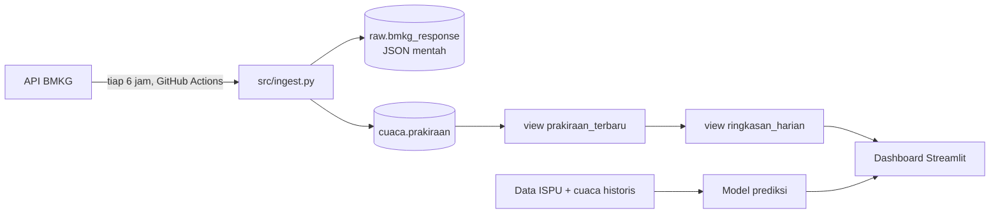

# Peringatan Dini Cuaca dan Kualitas Udara Jakarta

Proyek pribadi end-to-end: mengambil data cuaca secara terjadwal dari API publik BMKG,
menyimpannya di database, mengolahnya dengan SQL, lalu menampilkannya sebagai
dashboard peringatan. Tahap akhirnya adalah model prediksi kualitas udara.

## Untuk siapa

Pengguna yang dibayangkan: **petugas promosi kesehatan di puskesmas Jakarta**.
Mereka perlu tahu 2–3 hari sebelumnya kapan wilayahnya akan mengalami hujan lebat,
suhu ekstrem, atau kualitas udara buruk, supaya bisa menyiapkan layanan
(misalnya lonjakan pasien ISPA) dan mengirim imbauan ke warga.

Pertanyaan yang harus bisa dijawab dashboard:
1. Kelurahan mana yang diprakirakan hujan lebat atau panas ekstrem dalam 3 hari ke depan?
2. Bagaimana kualitas udara besok, dan seberapa yakin prediksinya? *(Tahap 3)*

## Arsitektur



## Tahapan

- [x] **Tahap 1: pipeline.** Ingest terjadwal, skema database, view SQL, test parsing.
- [ ] **Tahap 2: dashboard.** Streamlit, dipublikasikan agar bisa dibuka siapa saja.
- [ ] **Tahap 3: model.** Prediksi kategori ISPU besok dari data cuaca dan ISPU historis.

## Cara menjalankan

1. Buat database PostgreSQL gratis (misalnya Neon atau Supabase) dan salin connection string-nya.
2. Buat tabel dan view:
   ```bash
   psql "$DATABASE_URL" -f sql/001_schema.sql
   ```
3. Isi `config/locations.csv` dengan kode wilayah tingkat kelurahan (adm4).
4. Jalankan lokal:
   ```bash
   pip install -r requirements.txt
   pytest -q
   DATABASE_URL="postgresql://..." python src/ingest.py
   ```
5. Untuk jadwal otomatis: simpan `DATABASE_URL` di **Settings → Secrets and variables → Actions**
   repo GitHub, lalu jalankan workflow `ingest-bmkg` sekali secara manual dari tab Actions.

## Keputusan desain

- **Respons mentah disimpan.** Kalau logika parsing salah atau format API berubah, data lama bisa
  di-parse ulang tanpa harus mengambil ulang (yang tidak mungkin, karena prakiraan lama hilang dari API).
- **Prakiraan lama tidak ditimpa.** `analysis_date` masuk primary key, jadi tiap versi prakiraan
  untuk jam yang sama tersimpan. Ini membuka analisis "seberapa akurat prakiraan H-3 dibanding H-1".
- **Idempotent.** Job yang jalan dua kali tidak membuat data ganda (`ON CONFLICT DO NOTHING`).
- **Satu lokasi gagal tidak menggagalkan semua.** Tiap lokasi punya transaksinya sendiri; job baru
  dianggap gagal kalau semua lokasi gagal.
- **Patuh batas API.** Jeda 1,1 detik antar-request (batas BMKG 60 request/menit), plus retry
  dengan backoff untuk error sementara.
- **PostgreSQL, bukan database proprietary.** Supaya siapa pun bisa menjalankan ulang proyek ini gratis.
  Polanya sama untuk Oracle (`python-oracledb` + `MERGE`).

## Keterbatasan

- BMKG menyediakan **prakiraan**, bukan hasil pengukuran. Untuk melatih model di Tahap 3 dibutuhkan
  data cuaca historis terukur dari sumber lain.
- Ambang peringatan (hujan ≥ 50 mm/hari, suhu ≥ 35 °C) dihitung dari prakiraan per 3 jam,
  jadi sifatnya indikasi.
- GitHub menonaktifkan jadwal workflow di repo publik yang 60 hari tidak ada aktivitas.

## Sumber data

Prakiraan cuaca: **BMKG (Badan Meteorologi, Klimatologi, dan Geofisika)**, melalui API publik
`api.bmkg.go.id`. Sesuai ketentuan BMKG, sumber data wajib dicantumkan di aplikasi yang memakainya.
