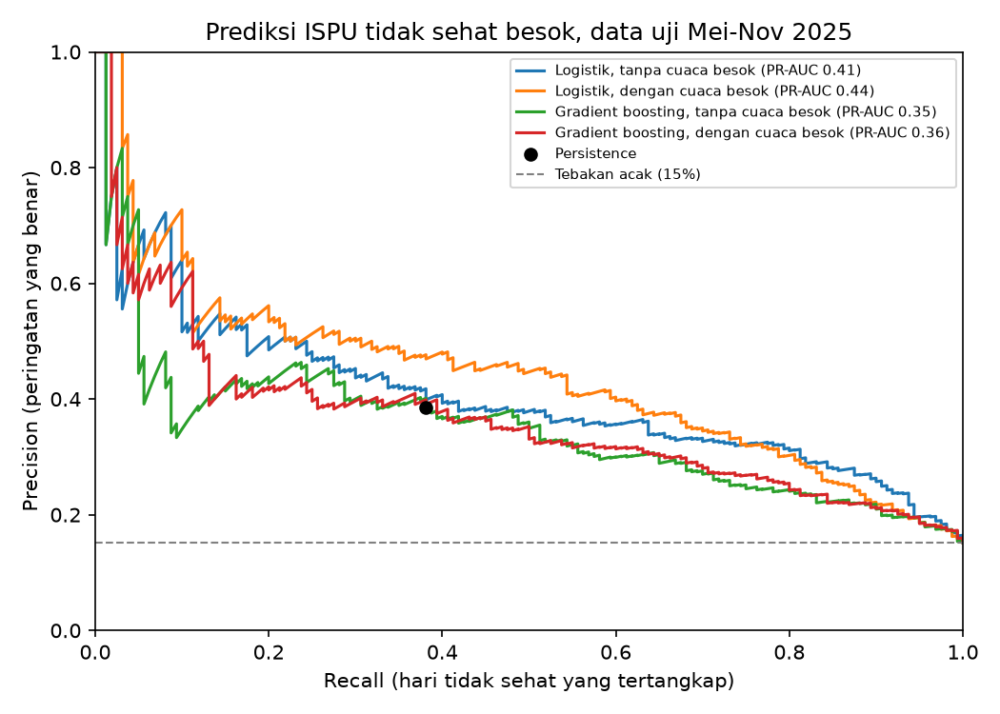

# Hasil model: ISPU tidak sehat besok

Data latih: 2377 baris stasiun-hari (s.d. 30 Apr 2025), 7.7% positif. Data uji: 1052 baris (Mei-Nov 2025), 15.2% positif.

## Perbandingan pendekatan (data uji)

| Pendekatan                            |   Recall |   Precision |    F2 |   PR-AUC |   Peringatan |   Ambang |
|:--------------------------------------|---------:|------------:|------:|---------:|-------------:|---------:|
| Persistence (besok = hari ini)        |    0.381 |       0.386 | 0.382 |  nan     |          158 |   nan    |
| Aturan musim (Mei-Agu = tidak sehat)  |    0.862 |       0.228 | 0.555 |  nan     |          604 |   nan    |
| Logistik, tanpa cuaca besok           |    0.969 |       0.189 | 0.531 |    0.406 |          820 |     0.27 |
| Logistik, dengan cuaca besok          |    0.919 |       0.216 | 0.557 |    0.44  |          680 |     0.36 |
| Gradient boosting, tanpa cuaca besok  |    0.906 |       0.199 | 0.53  |    0.352 |          728 |     0.05 |
| Gradient boosting, dengan cuaca besok |    0.906 |       0.21  | 0.545 |    0.364 |          691 |     0.06 |

## Trade-off model utama (logistik, dengan cuaca besok)

Dibaca dari kurva precision-recall data uji. Sebagai pembanding: aturan musim mencapai recall 0.86 dengan precision 0.23, persistence recall 0.38 dengan precision 0.39.

|   Target recall |   Precision model |
|----------------:|------------------:|
|            0.5  |             0.447 |
|            0.7  |             0.35  |
|            0.86 |             0.254 |

## Bisakah model memilah hari berisiko di dalam musim kemarau?

PR-AUC yang jauh di atas proporsi hari tidak sehat berarti model tidak sekadar menebak musim, tapi bisa mengurutkan hari mana yang paling berisiko.

| Periode      |   Proporsi hari tidak sehat |   PR-AUC model |
|:-------------|----------------------------:|---------------:|
| Mei-Agu 2025 |                       0.228 |          0.489 |
| Sep-Nov 2025 |                       0.049 |          0.153 |

## Model utama per stasiun (ambang F2 dari data latih)

| stasiun   |   Hari tidak sehat |   Tertangkap |   Alarm palsu |
|:----------|-------------------:|-------------:|--------------:|
| DKI1      |                 31 |           27 |           100 |
| DKI2      |                 30 |           28 |           121 |
| DKI3      |                 12 |            7 |            88 |
| DKI4      |                 42 |           41 |            92 |
| DKI5      |                 45 |           44 |           132 |

## Fitur paling berpengaruh (permutation importance, PR-AUC)

|                    |   Penurunan PR-AUC |
|:-------------------|-------------------:|
| hujan_3hari_besok  |             0.0634 |
| suhu_maks_besok    |             0.0596 |
| ispu_hari_ini      |             0.0487 |
| hujan_mm_hari_ini  |             0.0424 |
| ispu_kemarin       |             0.035  |
| musim_kemarau      |             0.0343 |
| suhu_maks_hari_ini |             0.0315 |
| stasiun            |             0.0214 |

